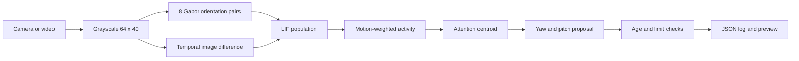

# CatBrain-T800

**Feline-inspired visual attention for an animatronic head.**

CatBrain-T800 converts camera images into orientation responses, spiking activity, and bounded head-orientation proposals. The processing runs locally, with inspectable parameters and a frame-by-frame JSON log.


*Project visualization: the red environment is a generated virtual viewpoint, and the anatomical activity overlay is illustrative. The executable pipeline below produces input, edge, and model-activity panels from actual frames; it does not reproduce this composite screenshot.*

## What runs today

- Local video files, USB cameras, and OpenCV-compatible network streams.
- Eight orientation channels with paired Gabor filters.
- A population of **20,480 leaky integrate-and-fire units**.
- Motion-weighted visual attention and horizontal/vertical target coordinates.
- Bounded yaw and pitch velocity proposals, with stale-input and stop handling.
- JSONL event logs, a runtime preview, and an optional live window.
- A deterministic moving-pattern input for installation and regression checks.

The software is a feline-inspired engineering model. Its parameters are not fitted to cat recordings, and its units are not a reconstructed cat connectome. No actuator driver is included: proposals are logged with `executed: false`. Physical T-800 head control requires a driver matched to the particular servos and controller board.

## Quick start

Use Python 3.10 or newer.

```bash
git clone https://github.com/bubblik525/CatBrain-T800.git
cd CatBrain-T800
python -m venv .venv
source .venv/bin/activate
# Windows PowerShell: .venv\Scripts\Activate.ps1
python -m pip install -e '.[test]'
catbrain --pattern --frames 300 --out runs/check
```

Open `runs/check/preview.jpg` and `runs/check/events.jsonl` to inspect the result. Choose a fresh output directory for each run; existing event logs are never overwritten.


### Process a video

```bash
catbrain --video /path/to/input.mp4 --frames 2000 --out runs/video
```

A run stops at end of file or at the requested frame count. File processing runs as fast as computation allows; it is not paced to source FPS. No source audio is read or copied.

### Use a USB camera

```bash
catbrain --camera 0 --frames 10000 --display --out runs/camera
```

Allow camera access in the operating system if prompted. Select the camera index that corresponds to the camera mounted on the head. Press `Q` or `Esc` to close the live view.

### Use a network camera

```bash
catbrain --stream 'rtsp://camera-host/stream' --frames 10000 --out runs/network
```

Codec and transport support depend on the local OpenCV build. Capture timeouts and reconnection are not implemented. Keep credentials out of committed configuration and shared shell history.

### Stop a run

```bash
touch runs/camera/STOP
```

The file is checked before each read and after model processing. A blocked capture read may delay this check. This software stop is not a hardware emergency stop.

## How it works



### 1. Visual encoding

Each frame is converted to grayscale and resized to 64 × 40. For each of eight orientations, two 9 × 9 Gabor filters operate in quadrature. Their combined magnitude represents local oriented structure. The previous frame supplies an absolute temporal difference, smoothed with a 3 × 3 kernel.

This stage extracts image structure and change. It does not recognize people, read text, infer depth, or compensate for camera motion.

### 2. Spiking population

There is one modeled unit per orientation and image position: `8 × 64 × 40 = 20,480`. Input current combines orientation energy and temporal change:

```text
current = clip(18 * orientation_energy + 6 * temporal_change, 0, 4)
voltage += (dt / tau) * (current - voltage)
spike when voltage >= 1; reset voltage to 0
```

Each frame advances ten steps of 5 ms, with a 20 ms membrane time constant. Thus each observation advances **50 ms of model time**, independently of video timestamps or wall-clock time. Rates are exponentially smoothed across observations. Gain, threshold, and timing are explicit engineering choices in `src/catbrain/model.py`.

These units share image input but have no recurrent synaptic connectivity. The anatomical connections in the header image are separate visual artwork.

### 3. Attention and head orientation

The mean rate across orientations is multiplied by temporal change. This emphasizes moving regions that also evoke model activity. The activity-weighted centroid produces normalized image coordinates:

- `target_x`: −1 at the left edge, +1 at the right edge.
- `target_y`: −1 at the top edge, +1 at the bottom edge.
- Positive yaw means **left**; positive pitch means **up**.

A ±0.12 dead zone suppresses small corrections. Yaw is clipped to ±0.15 rad/s and pitch to ±0.10 rad/s. These are **angular velocity proposals**, not servo positions or measured angles. Broad image changes affecting more than 65% of the processing grid suppress tracking. A stationary target eventually loses its motion gate.

### 4. Output validation

The guard rejects nonfinite values, out-of-range proposals, negative or >300 ms processing ages, and stop requests. The timestamp starts before capture, so this age includes the capture call and processing. It cannot detect frames already buffered upstream or recover their true exposure time.

All outputs are proposals. The current package does not send serial packets, move motors, or control eye LEDs.

## Files produced by a run

| File | Contents |
|---|---|
| `events.jsonl` | Frame number, model time, processing age, spikes, mean rate, raw and guarded intent, execution flag |
| `preview.jpg` | Camera frame, spatial edges, normalized activity, proposed yaw/pitch |
| `STOP` | Optional user-created stop marker |

The image is updated every 30 frames and on the configured last frame; at early EOF it can precede the final processed frame. Activity brightness is normalized per preview and is not an absolute firing-rate scale.

## Connecting a physical head

There is no universal T-800 SDK: animatronic heads use different boards, servo layouts, angle ranges, and communication protocols. See [Hardware integration](docs/HARDWARE.md) for the adapter boundary and calibration sequence.

The intended control chain is:

```text
head camera -> visual model -> guarded velocity intent
            -> hardware-specific pose controller -> servo controller
```

A pose controller must integrate velocity using elapsed wall time, enforce actual joint limits, apply acceleration limits, handle loss of input, and verify controller feedback. Eye illumination requires an independent hardware channel. None of these device-specific behaviors can be validated without the actual hardware.

## Development

```bash
python -m pip install -e '.[test]'
pytest -q
```

Tests cover deterministic activity, stationary and blank input, target-coordinate signs, global illumination changes, invalid values, angular limits, stale input, and stop precedence. GitHub Actions runs the suite on Python 3.10 and 3.12.

```text
src/catbrain/
  model.py       Orientation filters and spiking state
  attention.py   Target centroid and guarded head intents
  sources.py     Capture and moving-pattern input
  render.py      Runtime preview
  cli.py         Processing loop and logs
tests/           Behavioral checks
assets/          Project screenshot and attribution
docs/           Hardware integration notes
```

## Current engineering limits

The activity readout is a motion-attention heuristic, not object recognition or a learned gaze policy. Camera movement can produce false attention; the global-change gate only addresses some cases. The model has no stereo depth, SLAM, recurrent biological wiring, object memory, servo feedback, or physical robot validation. Processing throughput depends on the machine and capture backend; no fixed real-time rate is guaranteed.

## License and credits

Original code and documentation are MIT licensed. The visual asset contains third-party source imagery and separately generated elements; it is not covered by the code license. See [asset attribution](assets/ATTRIBUTION.md).
